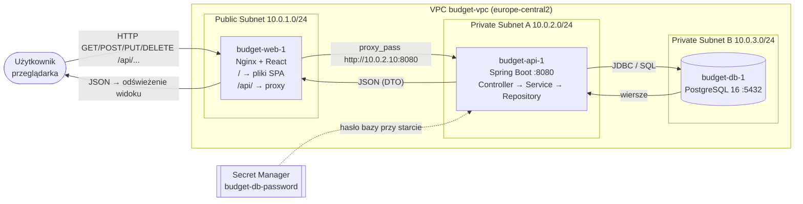
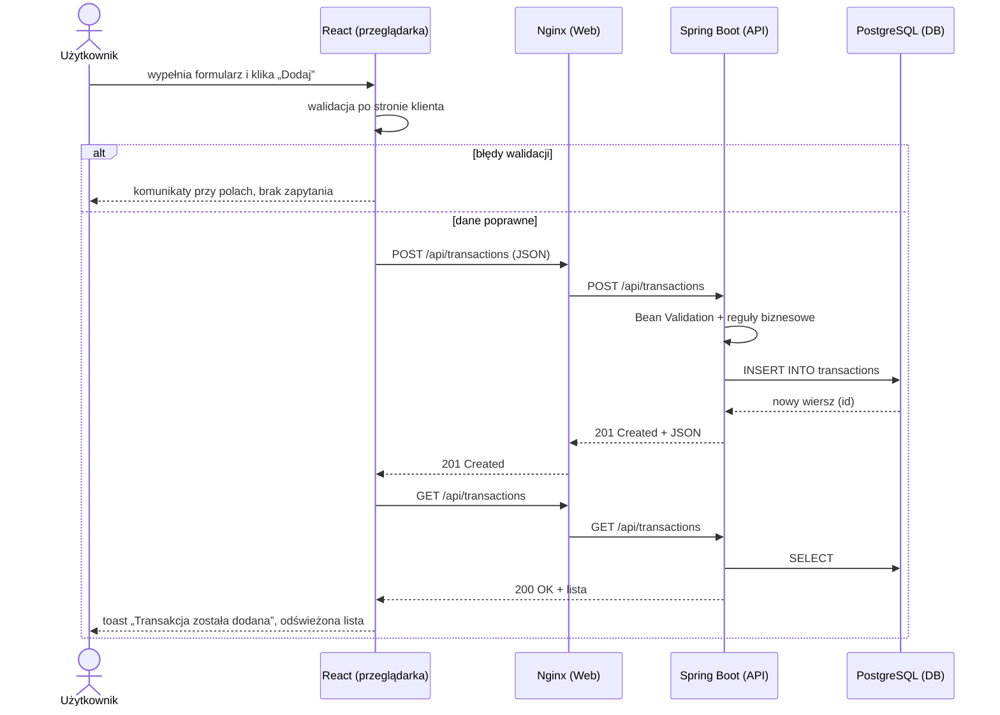

# Budget Application

Budget Application to webowa aplikacja do zarządzania budżetem osobistym. Użytkownik rejestruje przychody i wydatki, przypisuje je do kategorii, ustala miesięczne limity budżetowe i cele oszczędnościowe, a aplikacja prezentuje podsumowania i informuje o przekroczeniu limitów. Aplikacja jest wdrożona w GCP w izolowanej architekturze trójwarstwowej (Web / API / Database).

**Tablica projektu:** https://github.com/users/kaminskimarcin/projects/2/views/1

---

## Zespół

| Rola | Imię i nazwisko | Nr studenta |
|---|---|---|
| PM / DevOps / Frontend / Backend / DBA | Marcin Kamiński | 76209 |

---

## Stos technologiczny

| Warstwa | Technologia |
|---|---|
| Frontend | React 19 (Vite), Bootstrap 5, Nginx (serwowanie plików i reverse proxy `/api`) |
| Backend | Java 21, Spring Boot 4 (Spring Web MVC, Spring Data JPA, Bean Validation, Actuator), Flyway |
| Baza danych | PostgreSQL 16 (kontener Docker na VM w podsieci prywatnej) |
| Chmura | Google Cloud Platform (VPC, Compute Engine, Cloud NAT, Secret Manager, Cloud Storage – stan Terraform) |
| IaC | Terraform |
| CI/CD | GitHub Actions |
| Kontrola wersji | Git + GitHub |

---

## Architektura

Aplikacja działa w izolowanej architekturze trójwarstwowej (3-tier). Każda warstwa jest w osobnej podsieci VPC `budget-vpc` (region `europe-central2`).

| Warstwa | Podsieć | VM | Dostępność |
|---|---|---|---|
| Web (Nginx + React) | `budget-public-web` 10.0.1.0/24 | `budget-web-1` | publicznie z Internetu (HTTP 80) |
| API (Spring Boot) | `budget-private-api` 10.0.2.0/24 | `budget-api-1` (10.0.2.10) | brak publicznego IP, port 8080 tylko z podsieci Web |
| Baza danych (PostgreSQL) | `budget-private-db` 10.0.3.0/24 | `budget-db-1` (10.0.3.10) | brak publicznego IP, port 5432 tylko z podsieci API |

### Przepływ danych (end-to-end)



### Sekwencja zapisu (formularz → baza → widok)



Przeglądarka nigdy nie łączy się bezpośrednio z API: wszystkie zapytania idą na ten sam adres co strona (`/api/...`), a Nginx na `budget-web-1` przekazuje je do prywatnego adresu API. Dzięki temu API nie potrzebuje publicznego IP ani CORS w chmurze.

---

## 🔌 API – podsumowanie endpointów

Bazowy adres: lokalnie `http://localhost:8080/api`, w chmurze `http://<IP budget-web-1>/api`. Format danych: JSON, daty `RRRR-MM-DD`, kwoty jako liczby z maks. 2 miejscami po przecinku.

### Transakcje

| Metoda | Endpoint | Opis | Kody odpowiedzi |
|---|---|---|---|
| GET | `/api/transactions` | lista transakcji (sortowana po dacie) | 200 |
| GET | `/api/transactions/{id}` | jedna transakcja | 200, 400, 404 |
| POST | `/api/transactions` | dodanie transakcji | 201, 400 |
| PUT | `/api/transactions/{id}` | edycja transakcji | 200, 400, 404 |
| DELETE | `/api/transactions/{id}` | usunięcie transakcji | 204, 404 |

Przykładowe body (POST / PUT):

```json
{
  "date": "2026-10-24",
  "description": "Pizza z przyjaciółmi",
  "category": "Jedzenie",
  "amount": -74.90,
  "type": "EXPENSE"
}
```

Odpowiedź `201 Created` (nagłówek `Location: .../api/transactions/11`):

```json
{
  "id": 11,
  "date": "2026-10-24",
  "description": "Pizza z przyjaciółmi",
  "category": "Jedzenie",
  "amount": -74.90,
  "type": "EXPENSE"
}
```

Reguły: `type` = `INCOME` (kwota > 0) lub `EXPENSE` (kwota < 0), opis do 255 znaków, kategoria do 100 znaków.

### Budżety

| Metoda | Endpoint | Opis | Kody odpowiedzi |
|---|---|---|---|
| GET | `/api/budgets` | lista limitów miesięcznych | 200 |
| GET | `/api/budgets/{id}` | jeden budżet | 200, 400, 404 |
| POST | `/api/budgets` | dodanie budżetu dla kategorii | 201, 400 |
| PUT | `/api/budgets/{id}` | zmiana kategorii lub limitu | 200, 400, 404 |
| DELETE | `/api/budgets/{id}` | usunięcie budżetu | 204, 404 |

```json
{ "category": "Zdrowie", "limit": 300.00 }
```

Odpowiedź: `{ "id": 7, "category": "Zdrowie", "limit": 300.00 }`. Kategoria musi być unikalna (bez względu na wielkość liter), limit > 0.

### Cele oszczędnościowe

| Metoda | Endpoint | Opis | Kody odpowiedzi |
|---|---|---|---|
| GET | `/api/goals` | lista celów (sortowana po terminie) | 200 |
| GET | `/api/goals/{id}` | jeden cel | 200, 400, 404 |
| POST | `/api/goals` | dodanie celu | 201, 400 |
| PUT | `/api/goals/{id}` | edycja celu (np. dopłata do odłożonej kwoty) | 200, 400, 404 |
| DELETE | `/api/goals/{id}` | usunięcie celu | 204, 404 |

```json
{
  "name": "Nowy rower",
  "targetAmount": 3500.00,
  "savedAmount": 700.00,
  "deadline": "2027-05-31"
}
```

### Błędy

Każdy błąd ma ten sam format. Przykład `400 Bad Request`:

```json
{
  "timestamp": "2026-10-25T10:39:59.748Z",
  "status": 400,
  "error": "Bad Request",
  "message": "Niepoprawne dane wejściowe",
  "path": "/api/transactions",
  "fieldErrors": {
    "description": "Opis jest wymagany",
    "amount": "Kwota jest wymagana"
  }
}
```

| Kod | Znaczenie |
|---|---|
| 200 OK | poprawny odczyt lub aktualizacja |
| 201 Created | utworzono zasób, nagłówek `Location` wskazuje jego adres |
| 204 No Content | usunięto zasób |
| 400 Bad Request | błąd walidacji, niepoprawny JSON lub typ parametru |
| 404 Not Found | zasób o podanym `id` nie istnieje |
| 405 Method Not Allowed | metoda HTTP nieobsługiwana dla adresu |
| 500 Internal Server Error | nieoczekiwany błąd serwera (np. brak połączenia z bazą) |

Healthcheck: `GET /actuator/health` → `{"status":"UP"}`.

---

## ▶ Uruchomienie lokalne

Wymagania: Java 21, Maven 3.9+, Node.js 22, PostgreSQL 16 lub Docker Desktop.

### 1. Backend (`/backend`)

```bash
cd backend
cp .env.example .env
```

Uzupełnij `.env`:

```
DB_HOST=localhost
DB_PORT=5432
DB_NAME=budget
DB_USER=budget
DB_PASSWORD=<hasło>
CORS_ALLOWED_ORIGINS=http://localhost:5173
```

Wariant A – baza i API w Dockerze:

```bash
docker compose up -d --build
```

Wariant B – własny PostgreSQL (baza `budget` i użytkownik `budget` muszą istnieć):

```bash
mvn spring-boot:run
```

Flyway przy starcie tworzy tabele i dane startowe. Sprawdzenie: `curl http://localhost:8080/api/transactions`. Testy: `mvn test`.

### 2. Frontend (`/frontend`)

```bash
cd ../frontend
cp .env.example .env.local
npm install
npm run dev
```

Aplikacja: http://localhost:5173. Plik `.env.local` zawiera `VITE_API_BASE_URL=http://localhost:8080/api`. Testy walidacji: `npm test`, lint: `npm run lint`, build produkcyjny: `npm run build`.

---

## ☁ Wdrożenie w GCP (Cloud Shell)

```bash
cd backend
bash deploy/deploy-db.sh
bash deploy/deploy-api.sh
cd ../frontend
bash deploy/deploy-gcp.sh
```

`deploy-gcp.sh` buduje obraz Nginx z frontendem (`VITE_API_BASE_URL=/api`) i uruchamia go na `budget-web-1` ze zmienną `API_UPSTREAM=http://10.0.2.10:8080`. Aplikacja jest dostępna pod publicznym IP `budget-web-1`.

---

## Struktura repozytorium

```
budget-application/
├── .github/workflows/ci.yml   # CI: lint, testy i build frontendu oraz backendu
├── backend/                   # API – Java 21, Spring Boot (opis w backend/README.md)
├── config/                    # Szablony konfiguracji środowisk
├── docs/                      # Dokumentacja i sprawozdania z bloków
├── frontend/                  # Interfejs użytkownika – React (opis w frontend/README.md)
├── terraform/                 # Sieć VPC, podsieci i firewall w GCP
└── README.md
```

---

## ⚙ Konfiguracja

- Adresy usług (URL API, adres bazy danych) **nie są wpisane na sztywno w kodzie**, aplikacja odczytuje je ze zmiennych środowiskowych (`VITE_API_BASE_URL`, `API_UPSTREAM`, `DB_HOST`, `DB_*`, `CORS_ALLOWED_ORIGINS`).
- Pliki z prawdziwymi wartościami (`.env`, `.env.local`) nie trafiają do repozytorium. W GCP hasło do bazy jest w Secret Manager.

---

## 🔀 Praca z repozytorium i CI/CD

- Praca na gałęziach `feature/<nazwa>`, bez bezpośrednich commitów do `main`.
- Każda zmiana trafia do `main` przez Pull Request podpięty pod Issue z tablicy projektu.
- Workflow `CI` (GitHub Actions) uruchamia się dla każdego PR i pusha do `main`: frontend (`npm ci`, `lint`, `test`, `build`) oraz backend (`mvn verify`). Zielony status jest warunkiem merge i punktem wyjścia do automatycznego wdrożenia.
