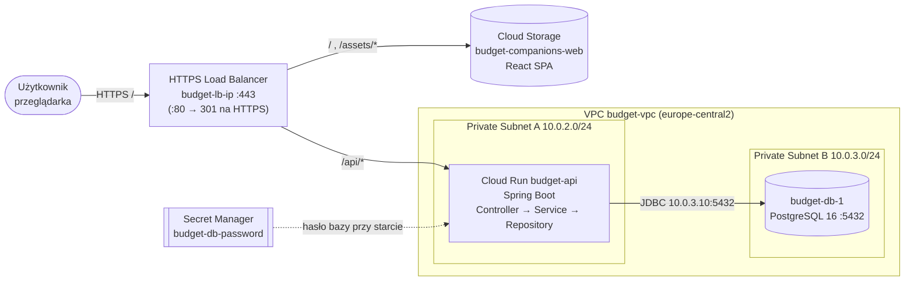
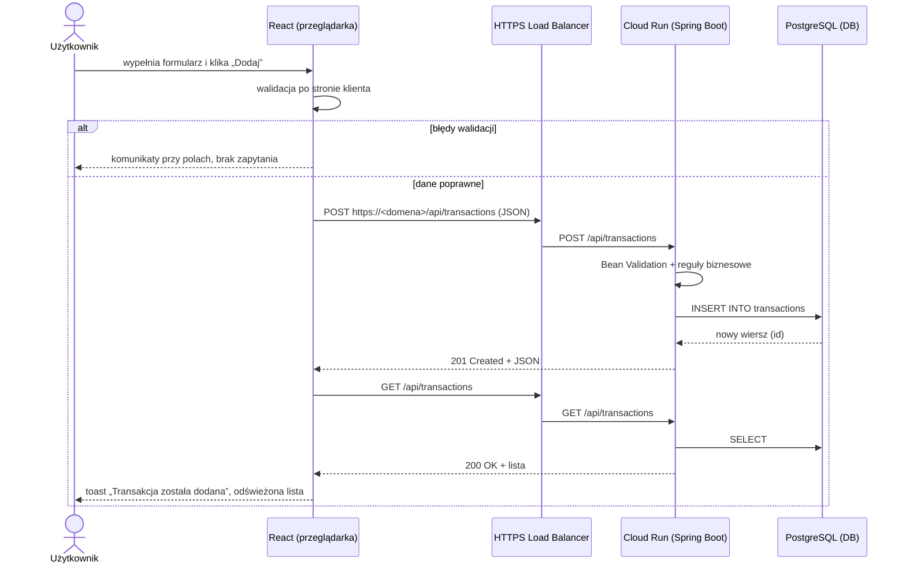

# Budget Application

Budget Application to webowa aplikacja do zarządzania budżetem osobistym. Użytkownik rejestruje przychody i wydatki, przypisuje je do kategorii, ustala miesięczne limity budżetowe i cele oszczędnościowe, a aplikacja prezentuje podsumowania i informuje o przekroczeniu limitów. Aplikacja jest wdrożona w GCP w izolowanej architekturze trójwarstwowej (Web / API / Database).

**Tablica projektu:** https://github.com/users/kaminskimarcin/projects/2/views/1

---

## Zespół

| Rola | Imię i nazwisko | Nr studenta |
|---|---|---|
| PM / DevOps / Frontend / Backend / DBA | Marcin Kamiński | 76209 |

---

## Stos technologiczny

| Warstwa | Technologia |
|---|---|
| Frontend | React 19 (Vite), Bootstrap 5; w chmurze pliki statyczne w Cloud Storage za HTTPS Load Balancerem |
| Backend | Java 21, Spring Boot 4 (Spring Web MVC, Spring Data JPA, Bean Validation, Actuator), Flyway |
| Baza danych | PostgreSQL 16 (kontener Docker na VM w podsieci prywatnej) |
| Chmura | Google Cloud Platform (VPC, Cloud Load Balancing + Google-managed SSL, Cloud Run, Cloud Storage, Compute Engine, Cloud NAT, Artifact Registry, Secret Manager) |
| IaC | Terraform |
| CI/CD | GitHub Actions |
| Kontrola wersji | Git + GitHub |

---

## Architektura

Aplikacja działa w izolowanej architekturze trójwarstwowej (3-tier) w VPC `budget-vpc` (region `europe-central2`). Jedynym publicznym wejściem jest globalny HTTPS Load Balancer z certyfikatem SSL zarządzanym przez Google.

| Warstwa | Usługa GCP | Sieć | Dostępność |
|---|---|---|---|
| Web (React) | HTTPS Load Balancer `budget-https-map` + bucket `budget-companions-web` | publiczny adres IP `budget-lb-ip` | HTTPS 443 z Internetu, HTTP 80 tylko przekierowuje na HTTPS |
| API (Spring Boot) | Cloud Run `budget-api` | Direct VPC egress z podsieci `budget-private-api` 10.0.2.0/24, tag `api` | ingress `internal-and-cloud-load-balancing`: tylko przez Load Balancer (`/api/*`) |
| Baza danych (PostgreSQL) | VM `budget-db-1` (10.0.3.10) | podsieć `budget-private-db` 10.0.3.0/24, tag `db` | brak publicznego IP, port 5432 tylko z podsieci API |

### Przepływ danych (end-to-end)



### Sekwencja zapisu (formularz → baza → widok)



Przeglądarka łączy się wyłącznie z Load Balancerem: strona i API są pod tym samym adresem (`/api/...`), więc w chmurze nie jest potrzebny CORS, a adres `*.run.app` usługi Cloud Run nie przyjmuje ruchu z Internetu.

---

## 🔒 Bezpieczeństwo i reguły zaporowe

Zasada najmniejszych uprawnień: żaden zasób nie ma szerszego dostępu do sieci, niż wynika to z jego roli. Reguły firewall VPC są zdefiniowane w Terraform (`terraform/main.tf`), Load Balancer i ustawienia Cloud Run w `deploy/setup-https-gcp.sh` i `.github/workflows/deploy.yml`.

### Inbound (ruch przychodzący)

| Warstwa | Reguła / mechanizm | Protokół i port | Źródło | Cel | Akcja |
|---|---|---|---|---|---|
| Web | `budget-https-rule` (Load Balancer) | TCP 443 (TLS 1.2+, polityka `budget-ssl-policy` MODERN) | 0.0.0.0/0 | `budget-https-proxy` → bucket / Cloud Run | allow |
| Web | `budget-http-rule` + `budget-http-redirect` | TCP 80 | 0.0.0.0/0 | odpowiedź 301 na `https://` | redirect |
| API | ingress Cloud Run `internal-and-cloud-load-balancing` | HTTPS `/api/*`, `/actuator/health`, `/actuator/info` | tylko Load Balancer | `budget-api` | allow |
| API | ingress Cloud Run | dowolny | Internet bezpośrednio na `*.run.app` | `budget-api` | deny (404) |
| Web | `budget-vpc-allow-web-http-https` | TCP 80, 443 | tylko Load Balancer Google 130.211.0.0/22, 35.191.0.0/16 | tag `web` (VM w podsieci publicznej) | allow |
| API | `budget-vpc-allow-api-from-web` | TCP 8080 | 10.0.1.0/24 (podsieć Web) | tag `api` (VM w podsieci API) | allow |
| DB | `budget-vpc-allow-db-from-api` | TCP 5432 | 10.0.2.0/24 (podsieć API) | tag `db` | allow |
| Wszystkie | `budget-vpc-allow-ssh-iap` | TCP 22 | 35.235.240.0/20 (tylko Identity-Aware Proxy, wymaga konta Google z rolą IAP) | VM | allow |
| Wszystkie | `budget-vpc-deny-all-ingress` (priorytet 65000, logowanie) | wszystkie | 0.0.0.0/0 | VM | deny |

Brak reguł wpuszczających 0.0.0.0/0 na porty 22 (SSH), 3389 (RDP), 5432 (PostgreSQL), 3306, 27017 i 8080. Maszyna bazy nie ma publicznego adresu IP.

### Outbound (ruch wychodzący)

| Warstwa | Mechanizm | Cel | Port | Akcja |
|---|---|---|---|---|
| Web | Load Balancer → backendy | bucket `budget-companions-web`, serverless NEG `budget-api-neg` | – | allow (wewnętrzna sieć Google) |
| API | Direct VPC egress `private-ranges-only` | adresy prywatne VPC (baza 10.0.3.10) | 5432 | allow |
| API | Cloud Run (poza VPC) | Secret Manager, Google APIs | 443 | allow |
| DB | Cloud NAT `budget-vpc-nat` (bez publicznego IP) | Internet: aktualizacje i obraz Docker | 80/443 | allow, tylko połączenia inicjowane z VM |
| DB | Private Google Access | Secret Manager | 443 | allow |
| Wszystkie | domyślna reguła VPC (implied) | odpowiedzi na dozwolone połączenia (firewall stanowy) | – | allow |

### Pozostałe zabezpieczenia

- HTTPS z certyfikatem Google-managed (`budget-cert`), automatyczne odnawianie, minimalna wersja TLS 1.2.
- Hasło bazy w Secret Manager, dostęp ma tylko konto `budget-api-run`.
- GitHub Actions loguje się do GCP przez OIDC (Workload Identity Federation), bez kluczy JSON; konto `github-deployer` ma tylko potrzebne role.
- CI: Gitleaks, Trivy, CodeQL i Dependabot (Blok 07).

---

## 🔌 API – podsumowanie endpointów

Bazowy adres: lokalnie `http://localhost:8080/api`, w chmurze `https://<APP_DOMAIN>/api`. Format danych: JSON, daty `RRRR-MM-DD`, kwoty jako liczby z maks. 2 miejscami po przecinku.

### Transakcje

| Metoda | Endpoint | Opis | Kody odpowiedzi |
|---|---|---|---|
| GET | `/api/transactions` | lista transakcji (sortowana po dacie) | 200 |
| GET | `/api/transactions/{id}` | jedna transakcja | 200, 400, 404 |
| POST | `/api/transactions` | dodanie transakcji | 201, 400 |
| PUT | `/api/transactions/{id}` | edycja transakcji | 200, 400, 404 |
| DELETE | `/api/transactions/{id}` | usunięcie transakcji | 204, 404 |

Przykładowe body (POST / PUT):

```json
{
  "date": "2026-10-24",
  "description": "Pizza z przyjaciółmi",
  "category": "Jedzenie",
  "amount": -74.90,
  "type": "EXPENSE"
}
```

Odpowiedź `201 Created` (nagłówek `Location: .../api/transactions/11`):

```json
{
  "id": 11,
  "date": "2026-10-24",
  "description": "Pizza z przyjaciółmi",
  "category": "Jedzenie",
  "amount": -74.90,
  "type": "EXPENSE"
}
```

Reguły: `type` = `INCOME` (kwota > 0) lub `EXPENSE` (kwota < 0), opis do 255 znaków, kategoria do 100 znaków.

### Budżety

| Metoda | Endpoint | Opis | Kody odpowiedzi |
|---|---|---|---|
| GET | `/api/budgets` | lista limitów miesięcznych | 200 |
| GET | `/api/budgets/{id}` | jeden budżet | 200, 400, 404 |
| POST | `/api/budgets` | dodanie budżetu dla kategorii | 201, 400 |
| PUT | `/api/budgets/{id}` | zmiana kategorii lub limitu | 200, 400, 404 |
| DELETE | `/api/budgets/{id}` | usunięcie budżetu | 204, 404 |

```json
{ "category": "Zdrowie", "limit": 300.00 }
```

Odpowiedź: `{ "id": 7, "category": "Zdrowie", "limit": 300.00 }`. Kategoria musi być unikalna (bez względu na wielkość liter), limit > 0.

### Cele oszczędnościowe

| Metoda | Endpoint | Opis | Kody odpowiedzi |
|---|---|---|---|
| GET | `/api/goals` | lista celów (sortowana po terminie) | 200 |
| GET | `/api/goals/{id}` | jeden cel | 200, 400, 404 |
| POST | `/api/goals` | dodanie celu | 201, 400 |
| PUT | `/api/goals/{id}` | edycja celu (np. dopłata do odłożonej kwoty) | 200, 400, 404 |
| DELETE | `/api/goals/{id}` | usunięcie celu | 204, 404 |

```json
{
  "name": "Nowy rower",
  "targetAmount": 3500.00,
  "savedAmount": 700.00,
  "deadline": "2027-05-31"
}
```

### Błędy

Każdy błąd ma ten sam format. Przykład `400 Bad Request`:

```json
{
  "timestamp": "2026-10-25T10:39:59.748Z",
  "status": 400,
  "error": "Bad Request",
  "message": "Niepoprawne dane wejściowe",
  "path": "/api/transactions",
  "fieldErrors": {
    "description": "Opis jest wymagany",
    "amount": "Kwota jest wymagana"
  }
}
```

| Kod | Znaczenie |
|---|---|
| 200 OK | poprawny odczyt lub aktualizacja |
| 201 Created | utworzono zasób, nagłówek `Location` wskazuje jego adres |
| 204 No Content | usunięto zasób |
| 400 Bad Request | błąd walidacji, niepoprawny JSON lub typ parametru |
| 404 Not Found | zasób o podanym `id` nie istnieje |
| 405 Method Not Allowed | metoda HTTP nieobsługiwana dla adresu |
| 500 Internal Server Error | nieoczekiwany błąd serwera (np. brak połączenia z bazą) |

Healthcheck: `GET /actuator/health` → `{"status":"UP"}`.

---

## ▶ Uruchomienie lokalne

Wymagania: Java 21, Maven 3.9+, Node.js 22, PostgreSQL 16 lub Docker Desktop.

### 1. Backend (`/backend`)

```bash
cd backend
cp .env.example .env
```

Uzupełnij `.env`:

```
DB_HOST=localhost
DB_PORT=5432
DB_NAME=budget
DB_USER=budget
DB_PASSWORD=<hasło>
CORS_ALLOWED_ORIGINS=http://localhost:5173
```

Wariant A – baza i API w Dockerze:

```bash
docker compose up -d --build
```

Wariant B – własny PostgreSQL (baza `budget` i użytkownik `budget` muszą istnieć):

```bash
mvn spring-boot:run
```

Flyway przy starcie tworzy tabele i dane startowe. Sprawdzenie: `curl http://localhost:8080/api/transactions`. Testy: `mvn test`.

### 2. Frontend (`/frontend`)

```bash
cd ../frontend
cp .env.example .env.local
npm install
npm run dev
```

Aplikacja: http://localhost:5173. Plik `.env.local` zawiera `VITE_API_BASE_URL=http://localhost:8080/api`. Testy walidacji: `npm test`, lint: `npm run lint`, build produkcyjny: `npm run build`.

---

## ☁ Wdrożenie w GCP

Jednorazowo w Cloud Shell (jako właściciel projektu):

```bash
cd backend && bash deploy/deploy-db.sh && cd ..
bash deploy/setup-cd-gcp.sh
bash deploy/setup-https-gcp.sh
```

`setup-cd-gcp.sh` tworzy konta usługowe, OIDC dla GitHub Actions, Artifact Registry i bucket. `setup-https-gcp.sh` usuwa reguły zapory otwierające porty zarządcze i bazodanowe dla 0.0.0.0/0, tworzy HTTPS Load Balancer z certyfikatem Google, przekierowanie HTTP → HTTPS i ogranicza ruch do Cloud Run tylko do Load Balancera. Na końcu wypisuje domenę do zmiennej `APP_DOMAIN` w GitHub.

Kolejne wdrożenia robi workflow `CD Deploy to GCP` po każdym merge do `main`: CI → Cloud Run → Cloud Storage → healthcheck (HTTPS, wersja, przekierowanie, blokada bezpośredniego dostępu do Cloud Run).

---

## Struktura repozytorium

```
budget-application/
├── .github/workflows/         # ci.yml (CI + skanery), deploy.yml (CD do GCP), codeql.yml
├── backend/                   # API – Java 21, Spring Boot (opis w backend/README.md)
├── config/                    # Szablony konfiguracji środowisk
├── deploy/                    # Skrypty GCP: OIDC/CD i HTTPS Load Balancer
├── docs/                      # Dokumentacja i sprawozdania z bloków
├── frontend/                  # Interfejs użytkownika – React (opis w frontend/README.md)
├── terraform/                 # Sieć VPC, podsieci i firewall w GCP
└── README.md
```

---

## ⚙ Konfiguracja

- Adresy usług (URL API, adres bazy danych) **nie są wpisane na sztywno w kodzie**, aplikacja odczytuje je ze zmiennych środowiskowych (`VITE_API_BASE_URL`, `DB_HOST`, `DB_*`, `CORS_ALLOWED_ORIGINS`), a domena aplikacji w GitHub Actions ze zmiennej `APP_DOMAIN`.
- Pliki z prawdziwymi wartościami (`.env`, `.env.local`) nie trafiają do repozytorium. W GCP hasło do bazy jest w Secret Manager.

---

## 🔀 Praca z repozytorium i CI/CD

- Praca na gałęziach `feature/<nazwa>`, bez bezpośrednich commitów do `main`.
- Każda zmiana trafia do `main` przez Pull Request podpięty pod Issue z tablicy projektu.
- Workflow `CI` (GitHub Actions) uruchamia się dla każdego PR: Gitleaks, Trivy, frontend (`npm ci`, `lint`, `test`, `build`) oraz backend (`mvn verify`). Zielony status jest warunkiem merge.
- Po merge do `main` workflow `CD Deploy to GCP` ponownie uruchamia CI i dopiero po jego sukcesie wdraża aplikację.
